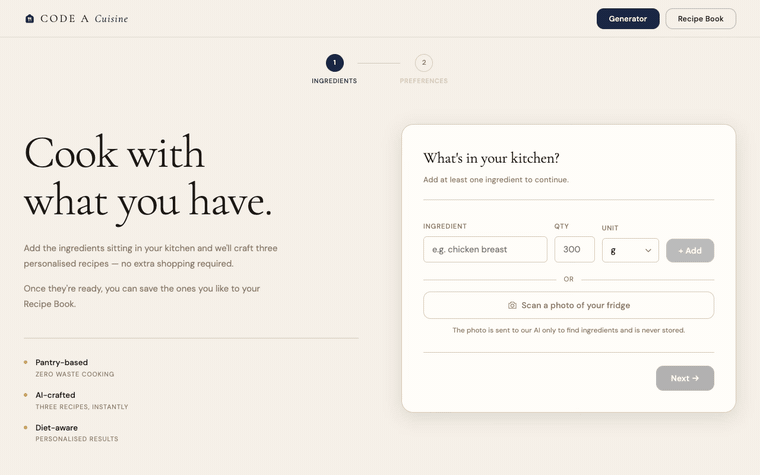
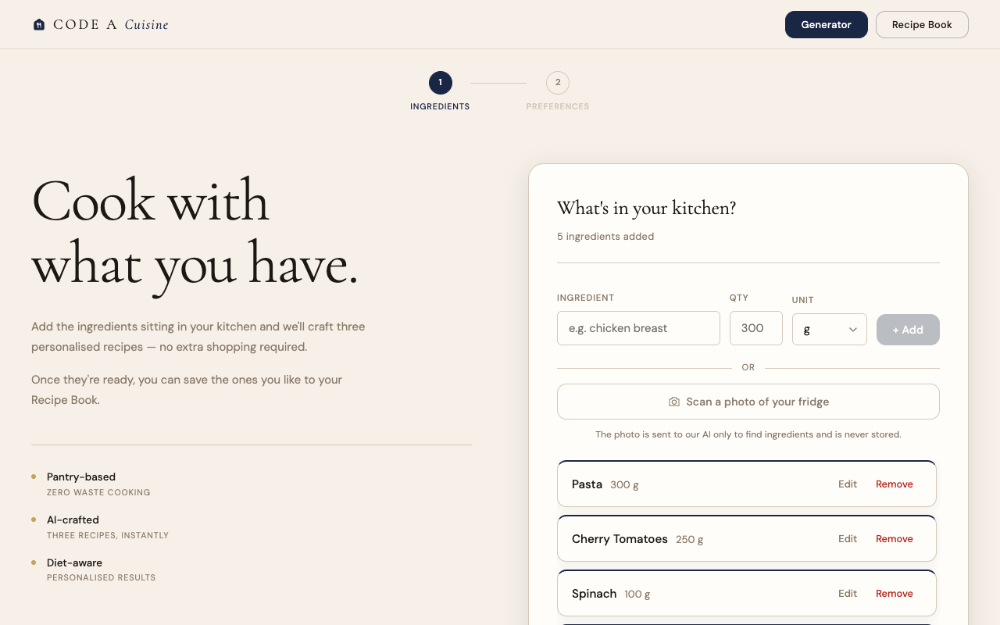
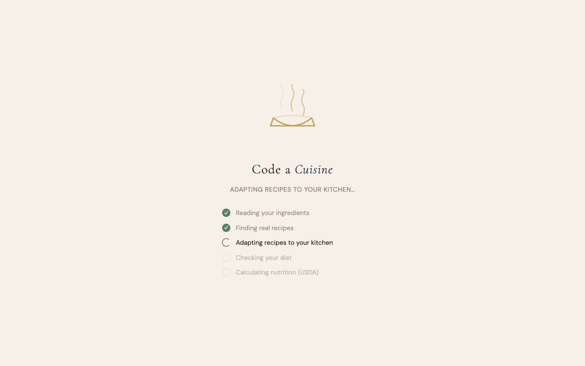
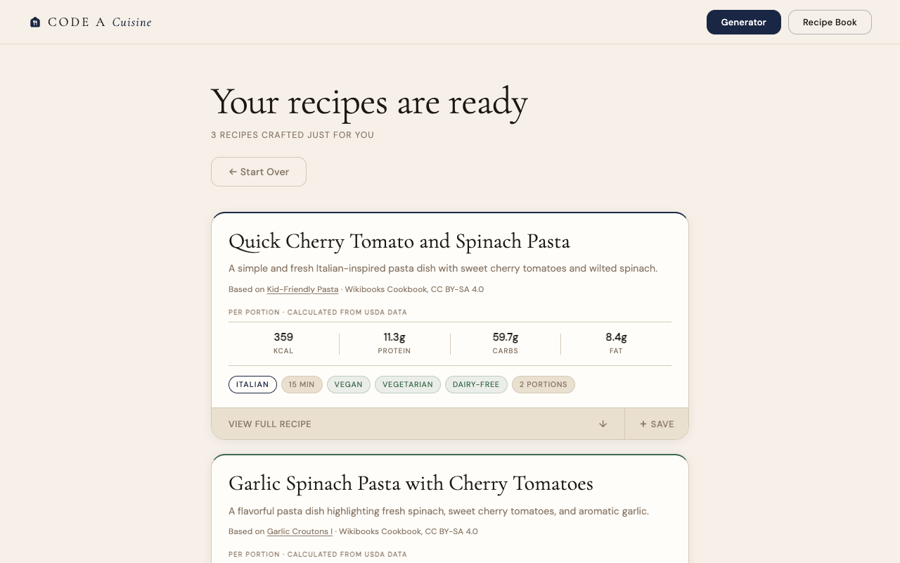
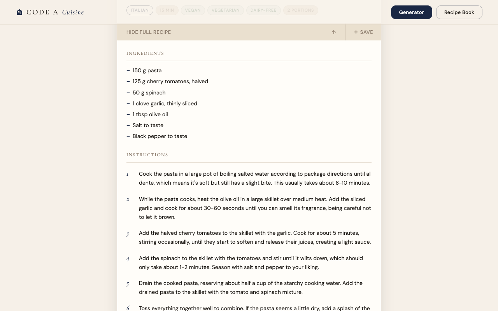
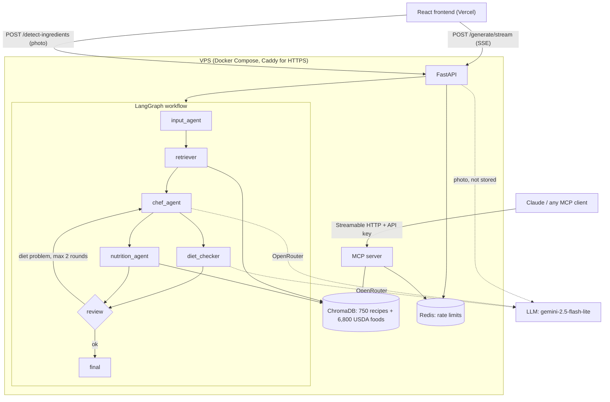

# 📝 Code a Cuisine

Tell the app what's in your kitchen, by typing it or by taking a photo of your fridge,
and get three recipes you can cook with what you already have.

The recipes are not made up by an LLM. They are **real recipes from a vector database**,
adapted to your ingredients by **AI agents that check each other**: one adapts the recipe,
one checks it against your diet, one calculates **real nutrition values from USDA data**.
The same recipe search and nutrition tools are also available to AI assistants like Claude
as an **MCP server**.

**Live:** [code-a-cuisine-three.vercel.app](https://code-a-cuisine-three.vercel.app/)



## Table of Contents

- [What it does](#what-it-does)
- [Architecture](#architecture)
- [Tech Stack](#tech-stack)
- [Evaluation: does the diet checker work?](#evaluation-does-the-diet-checker-work)
- [MCP server](#mcp-server)
- [Run it locally](#run-it-locally)
- [Tests](#tests)
- [Deployment](#deployment)
- [Folder Structure](#folder-structure)
- [Security](#security)
- [Data and Licenses](#data-and-licenses)

## What it does

| | |
|---|---|
|  |  |
| **Ingredients**: type them in or scan a fridge photo (a vision model lists what it sees; you can edit everything). | **Live progress**: the loading screen shows each agent step as it happens (Server-Sent Events). |
|  |  |
| **Results**: three recipes, each linked to the real recipe it is based on, with nutrition calculated from USDA data. | **Full recipe**: ingredient list and simple steps. Save it to the Recipe Book (in the browser, no account). |

- **Preferences:** portions, people, cooking time, cuisine and 7 diets (vegan, vegetarian, keto,
  gluten-free, dairy-free, low-carb, paleo).
- **Diet-safe:** ingredients that break your diet (e.g. honey for vegan) are swapped before
  cooking, and every recipe is checked again afterwards. Wrong diet labels are removed.
- **Honest nutrition:** calories, protein, carbs and fat are calculated in code from USDA
  FoodData Central, not guessed by the LLM.

## Architecture



**How one request flows:**

1. **input_agent** turns the user's ingredients (any language) into clean English search terms.
2. **retriever** (the only node with database access) runs a hybrid search in ChromaDB:
   ingredients as semantic query (all-MiniLM-L6-v2 embeddings, ONNX on CPU) plus metadata
   filters for diet, cuisine and cooking time. No match → a fallback chef writes recipes from scratch.
3. **chef_agent** adapts the best matches to the user's ingredients. It is told up front which
   of them break the diet, with a substitute (prevention beats repair, see
   [evaluation](#evaluation-does-the-diet-checker-work)). The LLM's JSON is validated against
   Pydantic schemas and sent back for repair if invalid (max 5 attempts).
4. **diet_checker** (rule check in code + LLM critic) and **nutrition_agent** (USDA lookup,
   unit → gram conversion, math in code) run **in parallel**.
5. **review** sends recipes with diet problems back to the chef (max 2 rounds), then **final**
   returns the frontend's JSON shape. Every step is streamed to the browser.

## Tech Stack

| Area | Choice |
|---|---|
| Frontend | React 19, Vite 8, plain CSS with design tokens, hosted on Vercel |
| Backend | Python 3.12, FastAPI, Pydantic v2, uv |
| Agents | LangGraph (shared state, parallel nodes, revision loop) |
| RAG | ChromaDB, all-MiniLM-L6-v2 embeddings (ONNX, CPU only), hybrid search |
| LLM | OpenRouter, `google/gemini-2.5-flash-lite` (text + vision), model names via env |
| Nutrition | USDA FoodData Central (SR Legacy), calculated in code |
| AI integration | MCP server (FastMCP): stdio locally, Streamable HTTP online |
| Infrastructure | Docker Compose (API, MCP, Redis), Caddy (HTTPS), Contabo VPS |
| Quality | pytest (220 tests, LLM and HTTP calls mocked), LLM-as-judge evaluation |

## Evaluation: does the diet checker work?

36 test requests across all 7 diets, most with a **trap** ingredient that breaks the diet
(honey for vegan, soy sauce for gluten-free, and 6 hidden ones like pesto with parmesan or
kimchi with fish sauce). Each request runs through the real workflow, then every recipe is
graded by an independent judge model (`anthropic/claude-haiku-5.5`, a different model family).

| Version | Change | Recipes breaking the diet (without → with checker) | Time | Cost / request |
|---|---|---|---|---|
| v1 | Baseline: chef + diet checker | **47 % → 21 %** | 12.5 s | $0.0021 |
| v2 | Chef is told up front which ingredients break the diet | 0 % → 1 % | 9.2 s | $0.0016 |
| v3 | Rules understand substitutes, fewer false alarms | 0 % → 0 % | 7.4 s | $0.0011 |
| v4 | +6 requests with hidden traps | **6 % → 1 %** | 7.6 s | $0.0012 |
| v5 | Rules know ready-made products (pesto, kimchi, stock cubes …) | 0 % → 1 %\* | 7.7 s | $0.0011 |

\* A judge error (eggs flagged for paleo, which allows them). All 108 recipes of v5 respect the diet.

**Takeaways:** the checker alone halved violations; telling the chef *before* cooking brought them
close to zero; the LLM critic catches what keyword rules cannot (anchovies in Caesar dressing).
Method, limitations and raw results: [backend/eval/README.md](backend/eval/README.md).

```bash
cd backend && uv run python -m eval.run   # ~10 cents, ~5 minutes
```

## MCP server

The recipe search and nutrition calculation are available to AI assistants via the
[Model Context Protocol](https://modelcontextprotocol.io). No LLM runs inside the server.

| Tool / Resource | What it does |
|---|---|
| `search_recipes` | Real recipes for a list of ingredients, with diet, cuisine and time filters |
| `get_recipe` | Full recipe by `itemId`, with source link |
| `get_nutrition` | Calories and macros per portion from USDA data, with the matched USDA food |
| `recipes://cuisines`, `recipes://diets` | Available cuisines and the exact diet rules |

**Online** (Streamable HTTP, API key required, rate limited):

```bash
claude mcp add --transport http code-a-cuisine https://cuisine-api.franekkaminski.dev/mcp \
  --header "Authorization: Bearer <your-key>"
```

**Locally** (stdio, after building the index):

```bash
claude mcp add code-a-cuisine -- uv --directory "/path/to/code-a-cuisine/backend" run python -m mcp_server.server
```

Then ask: *"I have chicken, rice and spinach. Find me a gluten-free recipe and tell me its
calories per portion."* Claude Desktop setup and details: [backend/mcp_server/README.md](backend/mcp_server/README.md).

## Run it locally

**Prerequisites:** Node.js 18+, Python 3.12 with [uv](https://docs.astral.sh/uv/), an
[OpenRouter API key](https://openrouter.ai/keys).

**Backend** (port 8000):

```bash
cd backend
cp .env.example .env                          # add OPENROUTER_API_KEY
uv sync
uv run python -m ingest.build_index           # builds the vector index from data/*.jsonl (~1-2 min)
uv run uvicorn api.main:app --reload
```

**Frontend** (port 5173), in a second terminal:

```bash
npm install
cp .env.example .env.local                    # VITE_API_URL=http://localhost:8000
npm run dev
```

Open <http://localhost:5173/>.

The recipe and USDA data are already in `backend/data/`. To rebuild them from the raw sources:
`uv run python -m ingest.run` (Wikibooks → LLM → validated JSON) and `uv run python -m ingest.usda`.

## Tests

```bash
cd backend && uv run pytest     # 220 tests, no network or API key needed
npm run lint                    # frontend
```

Tests cover the schemas, LLM validation + auto-repair, rate limiting, retrieval, nutrition math,
diet rules, the LangGraph workflow, the vision endpoint, the API and both MCP transports.
All LLM and HTTP calls are mocked.

## Deployment

- **Frontend:** Vercel (Vite preset). Env var `VITE_API_URL=https://cuisine-api.franekkaminski.dev`.
  `backend/` is excluded via [.vercelignore](.vercelignore).
- **Backend:** on the VPS, `git pull`, then `cd backend && docker compose up -d --build`.
  The vector index is built into the Docker image. API and MCP bind to `127.0.0.1` only;
  Caddy terminates HTTPS and routes `/mcp*` to the MCP container, everything else to the API.

## Folder Structure

```
src/                       React frontend
  api.js                   Calls the backend, reads the SSE progress stream
  components/              Steps, loading screen, results, recipe card, Recipe Book
backend/
  api/main.py              FastAPI: /generate, /generate/stream, /detect-ingredients, /health
  core/
    schemas.py             Pydantic models, used everywhere
    llm.py                 OpenRouter call + validation + auto-repair
    retrieval.py           Recipe search in ChromaDB
    nutrition.py           USDA lookup and nutrition math
    diet_rules.py          Deterministic diet checks
    vision.py              Photo → ingredients
    agents/graph.py        LangGraph workflow
  ingest/                  Wikibooks + USDA → JSON → ChromaDB
  mcp_server/              MCP server (stdio + Streamable HTTP)
  eval/                    Evaluation set, judge and results
  tests/                   pytest
  Dockerfile, docker-compose.yml
```

## Security

- API keys only in `.env` files, never in the frontend bundle or the repo.
- Input validated with Pydantic (≤ 20 ingredients, allow-listed units, diets and cuisines,
  10 KB body cap); photos ≤ 4 MB, type checked, never stored.
- Rate limits in Redis: 15 requests/day and 5/minute per IP, 300/day overall. IPs are hashed.
  The MCP server has its own per-key limits.
- CORS only for the Vercel domain. MCP server with API keys and Host-header checks.
- User input only ends up as text inside the prompt; LLM output is schema-validated before use.

## Data and Licenses

- Code: MIT, see [LICENSE](LICENSE).
- Recipes: adapted from the [Wikibooks Cookbook](https://en.wikibooks.org/wiki/Cookbook:Table_of_Contents),
  CC BY-SA 4.0 (each result links to its source). See [backend/data/README.md](backend/data/README.md).
- Nutrition: [USDA FoodData Central](https://fdc.nal.usda.gov/), SR Legacy, public domain.
